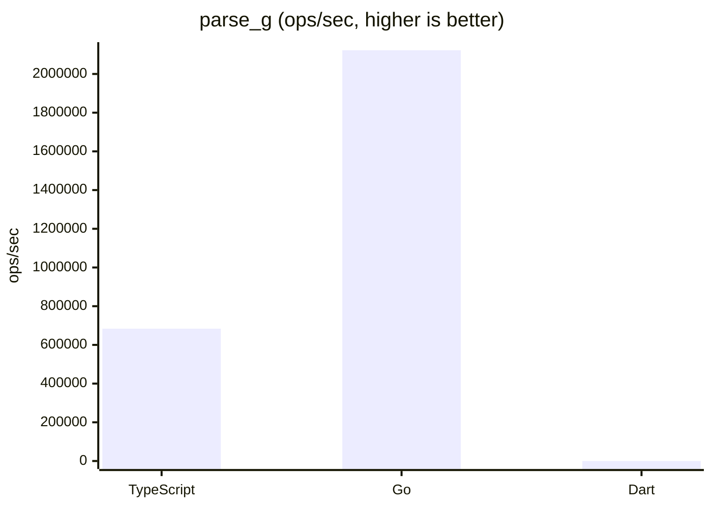
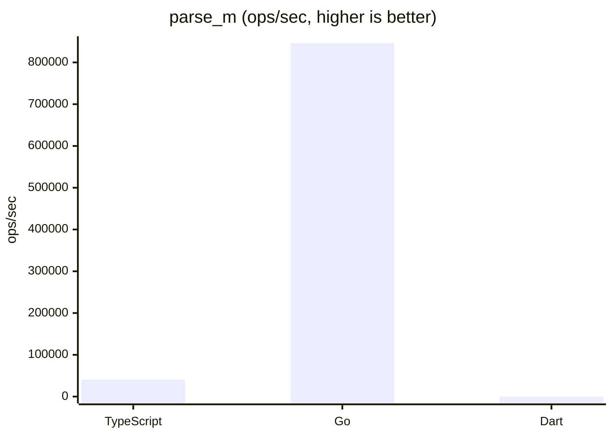
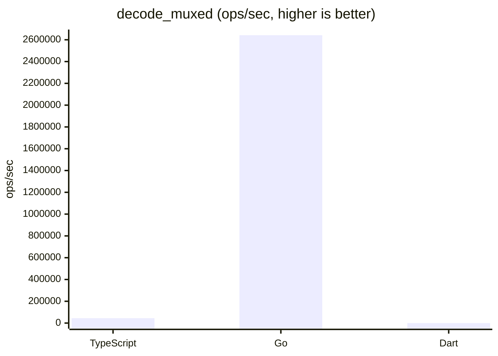
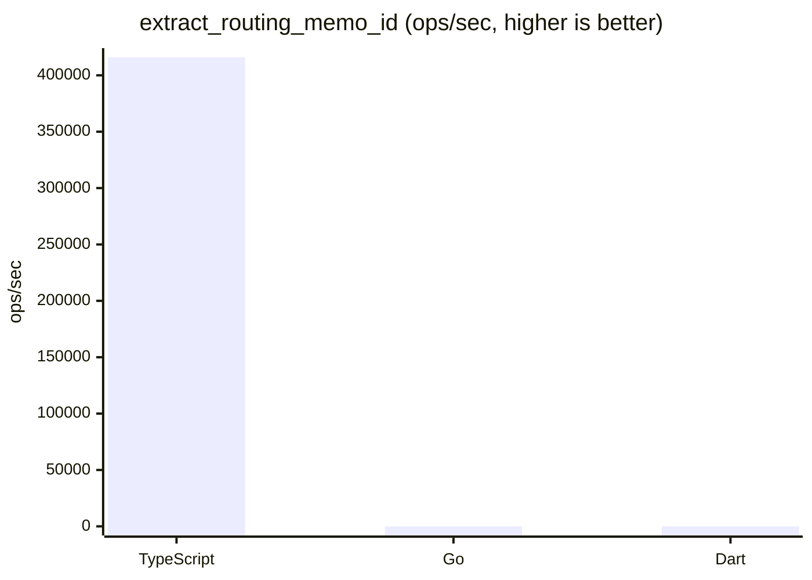

{/* Generated by scripts/run-parity-benchmarks.sh. Do not edit by hand; re-run the script. */}

Each workload uses the same inputs in every language and the runtimes run one after another on one host, so the numbers are directly comparable. Higher is better.

## Environment

| | |
|---|---|
| Date | 2026-11-20 |
| Commit | `6e5b0f9` (+ uncommitted changes under packages/) |
| CPU | INTEL(R) XEON(R) PLATINUM 8573C (2 logical cores) |
| OS | Linux 6.8.0-1070-azure x86_64 |
| Time per workload | 1s |
| CPU pinning | none |
| TypeScript | Node v24.22.2, vitest 5.0.5 |
| Go | **failed**: go1.27.3; package(s) failed to build or run: routing |
| Dart | **skipped**: dart not installed |

## Results (ops/sec)

| Workload | TypeScript | Go | Dart | Fastest |
|---|---:|---:|---:|---|
| `parse_g` parse(G address) | 683,770 (0.32x) | **2,122,692** | n/a | Go |
| `parse_m` parse(M address) | 40,226 (0.05x) | **846,024** | n/a | Go |
| `decode_muxed` decodeMuxed(M address) | 45,196 (0.02x) | **2,642,008** | n/a | Go |
| `extract_routing_memo_id` extractRouting(G + MEMO_ID) | **415,948** | n/a | n/a | TypeScript |

Values in parentheses are relative to the fastest runtime for that workload. `n/a` means the runtime was skipped or failed; see Environment.

## Charts

### parse(G address)



### parse(M address)



### decodeMuxed(M address)



### extractRouting(G + MEMO_ID)



## Reproducing

```bash
pnpm install
PIN_CPU=2 BENCH_TIME=2 scripts/run-parity-benchmarks.sh
```

Workload sources: `packages/core-ts/bench/parity.bench.ts`, `packages/core-go/{address,muxed,routing}/parity_bench_test.go` and `packages/core-dart/benchmark/parity_benchmark.dart`. Keep them in sync when adding a workload.
