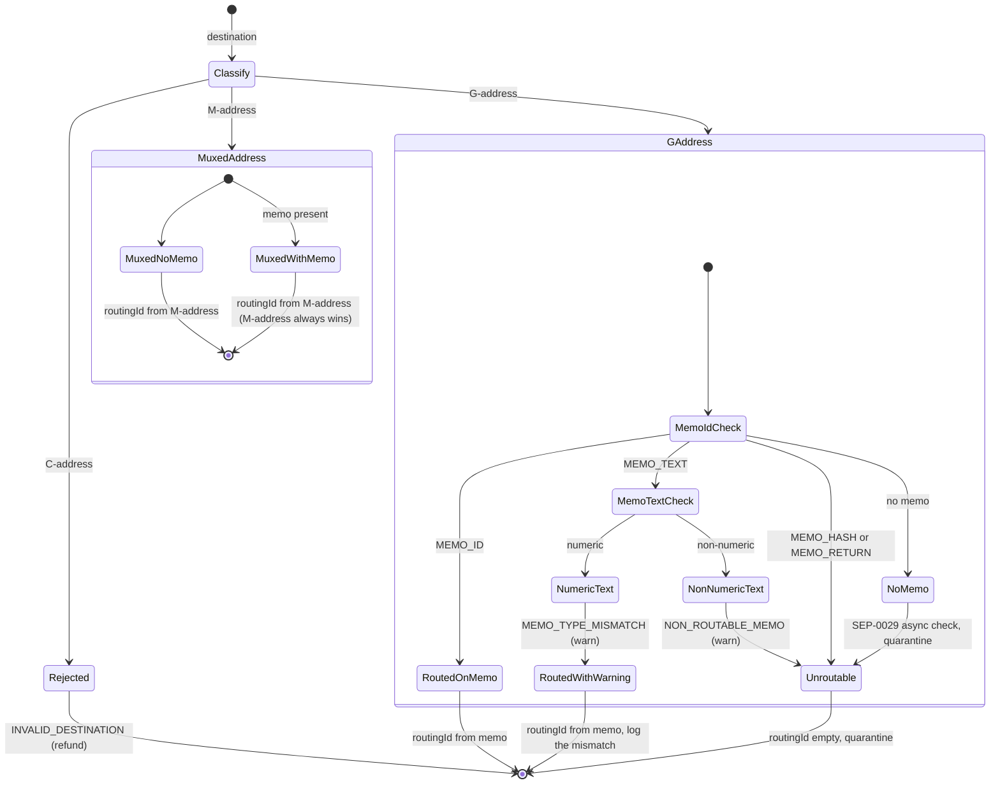

# Deposit routing state machine

This page shows the decision points for reconciling a memo with a muxed address. It follows the rules in [Routing Logic](../docs/concepts/routing-logic.mdx) and [Threat Model](../docs/concepts/threat-model.mdx). The diagram covers the four scenarios from #394. The sequence diagram in Routing Logic covers the full flow.

## Scenarios

| Input | Routing ID | Warning | Source |
|---|---|---|---|
| G-address + `MEMO_ID` | memo value | none | [Routing Logic](../docs/concepts/routing-logic.mdx) |
| G-address + `MEMO_TEXT` (numeric) | memo value | `MEMO_TYPE_MISMATCH` (warn) | Routing Logic |
| G-address + `MEMO_TEXT` (non-numeric) | empty | `NON_ROUTABLE_MEMO` (warn) | Routing Logic |
| M-address, no memo | M-address ID | none | Routing Logic |
| M-address + memo | M-address ID | see the conflict note below | Threat Model |

## Open point: memo sent with an M-address

The two docs name the warning differently:

- [Routing Logic](../docs/concepts/routing-logic.mdx) uses `REDUNDANT_MEMO` (INFO) for an external memo sent with an M-address.
- [Threat Model](../docs/concepts/threat-model.mdx) uses `MEMO_PRESENT_WITH_MUXED` (warn) for an ID memo or numeric text memo sent with an M-address.

Both docs agree that the M-address ID wins and the memo is not used for routing. They do not agree on the warning code or severity. The threat model also does not say what happens to a non-numeric memo with an M-address. This page does not choose between them. Resolve this in the docs before implementations rely on either warning.
